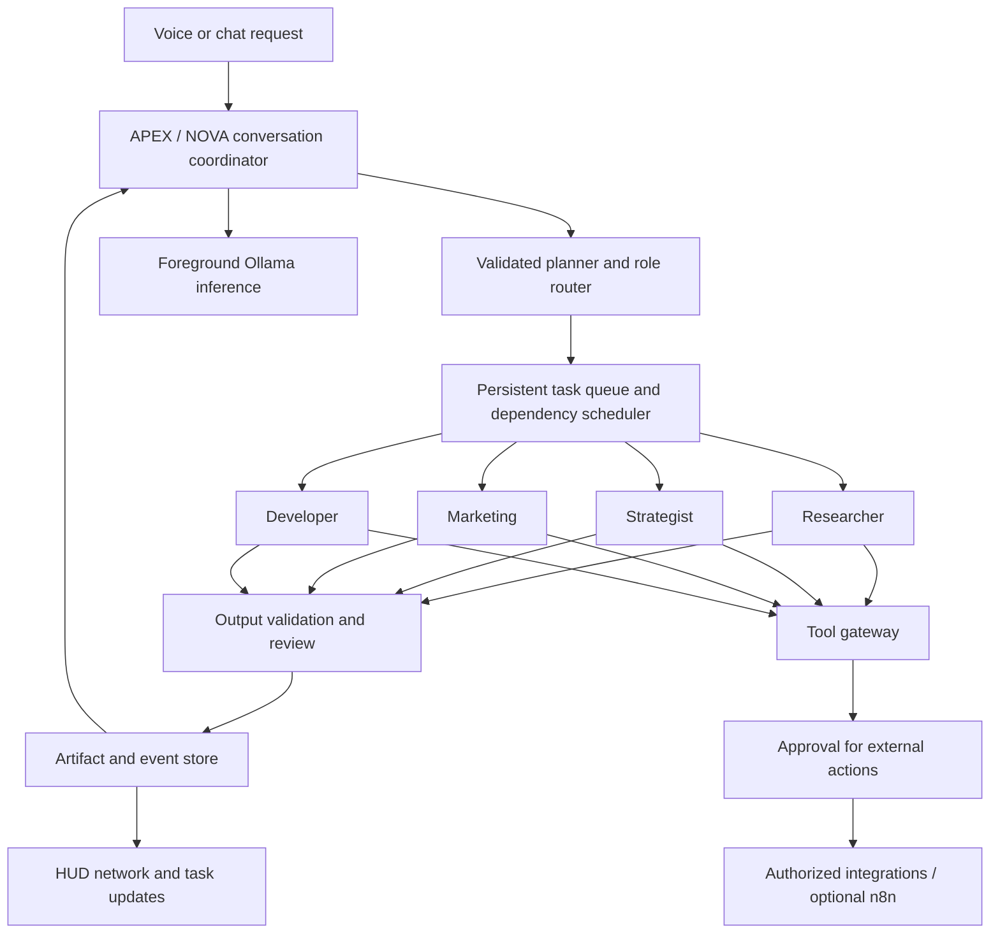

# APEX agent network: architecture and implementation roadmap

Design date: 7 October 2026, Asia/Kuala_Lumpur.

APEX should remain a responsive conversational coordinator while bounded background workers complete tasks. NOVA is another personality and voice of this system; she shares its task registry and action permissions. Separate conversation state from background execution so a new request never overwrites a running task.

## What exists in this build

The Next.js 15/React 19 HUD uses APEX-UI's SVG ReasoningWeb around the existing particle core. It receives runtime snapshots and server-sent task events. Registered text roles use solid nodes; planned Marketing/Developer use dashed nodes. Clicking a node opens its capabilities and observed active-step count. A pulse means a recorded step started, not hidden model reasoning or proof that agents communicated. Task content is not rendered into the network.

Chief of Staff, Researcher, Strategist, Editor and Social are registered text roles using local Qwen/Ollama. Researcher can analyze supplied material; it cannot currently browse. Social drafts only. The engine already stores workflows, task/step results and memory in SQLite, provides a bounded execution/review loop, and prioritizes foreground conversation over background inference. Marketing and Developer execution handlers, external tools, n8n, PostgreSQL and editable visual workflows remain roadmap items.

Fish Audio output for APEX has been tested with voice cae9af8ace0544c28879587a3496d6f0. Deepgram Flux English input still needs a corrected private API key. NOVA retains her separate Fish voice and local Whisper input. These speech services require their own account access; the local brain does not make cloud speech universally free.

## Architecture



Use a central coordinator and scheduler rather than uncontrolled agents messaging each other. Each worker receives a task ID, role instructions, selected source material, accepted outputs from dependencies, permitted tools and execution limits. It returns a structured deliverable to the coordinator. This keeps conversation responsive, makes work inspectable and prevents recursively spawned work from exhausting the local model.

The conversation lane acknowledges a queued request immediately and answers unrelated follow-ups. Background workers report real stage changes such as queued, executing, checking and awaiting input. Spoken updates should be deduplicated and scheduled between replies; do not say "on it" repeatedly or invent progress percentages. Start with the current two inference slots and at most one background inference call; tune only after measuring voice latency and memory use on this PC.

## Role contracts

| Role | Receives | Produces | Tools to add later |
| --- | --- | --- | --- |
| Coordinator / Chief of Staff | User goal and task snapshot | Clarification, validated plan, final synthesis | Read task registry; queue/cancel approved work |
| Researcher | Question and supplied sources | Evidence summary with source references and uncertainties | Allowlisted web search and read-only retrieval |
| Strategist | Goal, constraints and accepted evidence | Options, recommendation and measurable next steps | Read evidence and artifacts |
| Marketing | Audience, offer, brand rules and approved findings | Campaign plan, copy and draft assets | Read approved brand assets; prepare publishing drafts |
| Developer | Specification, permitted repository and acceptance checks | Proposed patch, review and test evidence | Isolated checkout and sandboxed test runner |
| Editor / Social | Supplied drafts and audience | Revised text / captions | Draft storage |

A role-specific prompt improves specialization but does not create a separately trained model. Begin with one local Qwen model and distinct system instructions. Add a different local coding model only after evaluations justify the extra memory. Selected dependencies pass artifacts to the next role; workers do not share an unrestricted conversation history or permanent credentials.

## Tool choices

| Layer | Recommended starting choice | When to expand |
| --- | --- | --- |
| Main HUD network | Existing APEX-UI ReasoningWeb SVG plus Three.js core | Keep for the requested orbital appearance |
| Editable workflow designer | React Flow / `@xyflow/react` | Add a separate editor when users need to connect, drag and configure steps; do not replace the HUD with another cluttered workspace |
| Automation | Optional self-hosted n8n | Add reviewed workflows for Outlook, calendar, files and messaging after the tool gateway exists |
| Local persistence | Existing SQLite with WAL | Suitable starting point for one desktop assistant; add schema migrations and transactional job claims |
| Shared/server persistence | PostgreSQL | Migrate when multiple users/workers need concurrent access, stronger querying or remote service operation |
| Brain | Local Ollama with Qwen | Keep provider adapters server-side; add cloud providers only if explicitly selected |
| Delivery | Existing REST commands plus SSE events | Add WebSockets only for bidirectional live interactions that need them |

n8n reduces connector work, but should not replace the task engine or grant an LLM arbitrary workflow access. Connect named, narrowly scoped operations through authenticated webhooks with idempotency keys and timeouts. n8n is fair-code under its Sustainable Use License, not MIT; check its terms before redistributing or offering hosted access. React Flow is useful for editable nodes and edges, while the upstream SVG is already appropriate for the animated HUD.

## API and node communication

The server calls Ollama's `POST /api/chat` with a per-role system message and only the task's relevant messages. Where structured outputs are supported, request a JSON schema, then validate the actual response independently. Model tool calls are requests to the gateway, never authorization to execute. Unsupported model/tool combinations should return a clear configuration error.

Suggested message envelope:

```json
{
  "taskId": "uuid",
  "stepId": "uuid",
  "role": "researcher",
  "goal": "Summarize the supplied comparison",
  "inputArtifactIds": ["artifact-uuid"],
  "allowedTools": ["artifact.read"],
  "acceptance": ["Every factual claim references supplied evidence"],
  "limits": {"attempts": 2, "toolCalls": 4, "timeoutSeconds": 120}
}
```

Proposed additional API contracts: `POST /tasks/plan` returns a reviewable dependency graph; `POST /tasks/:id/run` queues its validated version; `POST /tasks/:id/cancel` requests cancellation; `POST /actions/:id/confirm` approves an exact action. These endpoints are proposals, not currently implemented APIs. The existing `/api/runtime/state` and `/api/runtime/events` feed the network today.

Use events with task/step ID, role, event sequence, stage, timestamp and artifact references. Persist events before publishing them. Clients reconnect using the last delivered sequence so a dropped connection cannot fabricate completion. The network should distinguish available, queued, running, checking, awaiting approval, completed and failed; future edge animations represent actual dependency handoffs. Show concise execution summaries and receipts rather than private chain-of-thought.

For sending messages or email, prepare an immutable action containing channel, recipient, subject/body and attachment references. Read back the recipient and message, ask for explicit confirmation, then execute that exact version once. Any edit invalidates confirmation. Store a provider receipt or an explicit failure. Preserve this requirement for both personalities and every worker.

## Build, test and deployment phases

| Phase | Deliverable | Completion check |
| --- | --- | --- |
| 1. Interface and voice | Current HUD, reasoning network, Fish output; correct Flux key | Confirm speaker playback, final-turn recognition and keyboard/touch node access; stop releases microphone |
| 2. Registered specialists | Add Marketing and Developer as bounded text roles; enforce role schemas | Queue a task for each role; unrelated conversation stays responsive; unsupported tools cannot execute |
| 3. Dependency orchestration | Persist a validated plan with dependency IDs, artifacts, statuses and limits | Research → strategy → copy only advances on accepted outputs; failed dependencies block downstream steps; retries remain bounded |
| 4. Read-only tools | Authorized source retrieval, file reads and citations | Requests stay within permitted sources; injected source instructions cannot expand permissions |
| 5. Approved actions | Tool gateway plus recipient/message readback and optional n8n connectors | Edited drafts need new approval; duplicate submissions cannot send twice; delivery receipts appear in the task |
| 6. Editable workflows | React Flow editor outside the HUD and versioned saved definitions | Reject cycles and invalid roles; saved workflows remain reproducible; simulation clearly differs from live execution |
| 7. Learning and evaluation | Curated corrections, retrieval memory and exported training data | Score held-out tasks before/after changes; saving examples never claims to retrain weights; maintain rollback |
| 8. Deployment | Local launcher first; optional packaged Windows app and remote server later | Restart recovery, backups, cancellation, secrets, connectivity failures and audio-device changes pass checks |

Do not rebuild the existing working UI from scratch. Continue from phases 1–2, then add one real tool at a time. For local deployment keep credentials server-side and services bound to loopback. A future remote deployment requires authentication, TLS, per-user isolation and gateway authorization before exposing the runtime. Docker Compose can later manage PostgreSQL/n8n; it is not required for the current desktop build.

## Official references

- [APEX-UI ReasoningWeb source](https://github.com/RubenM1990/APEX-UI/blob/main/components/ReasoningWeb.jsx)
- [Ollama chat API](https://docs.ollama.com/api/chat), [structured outputs](https://docs.ollama.com/capabilities/structured-outputs), [tool calling](https://docs.ollama.com/capabilities/tool-calling)
- [React Flow](https://reactflow.dev/)
- [n8n AI Agent](https://docs.n8n.io/integrations/builtin/cluster-nodes/root-nodes/n8n-nodes-langchain.agent/), [self-hosting](https://docs.n8n.io/choose-how-to-use-n8n), [license](https://support.n8n.io/article/can-i-use-your-license-for-my-use-case)
- [SQLite deployment suitability](https://www.sqlite.org/whentouse.html), [PostgreSQL documentation](https://www.postgresql.org/docs/current/index.html)
