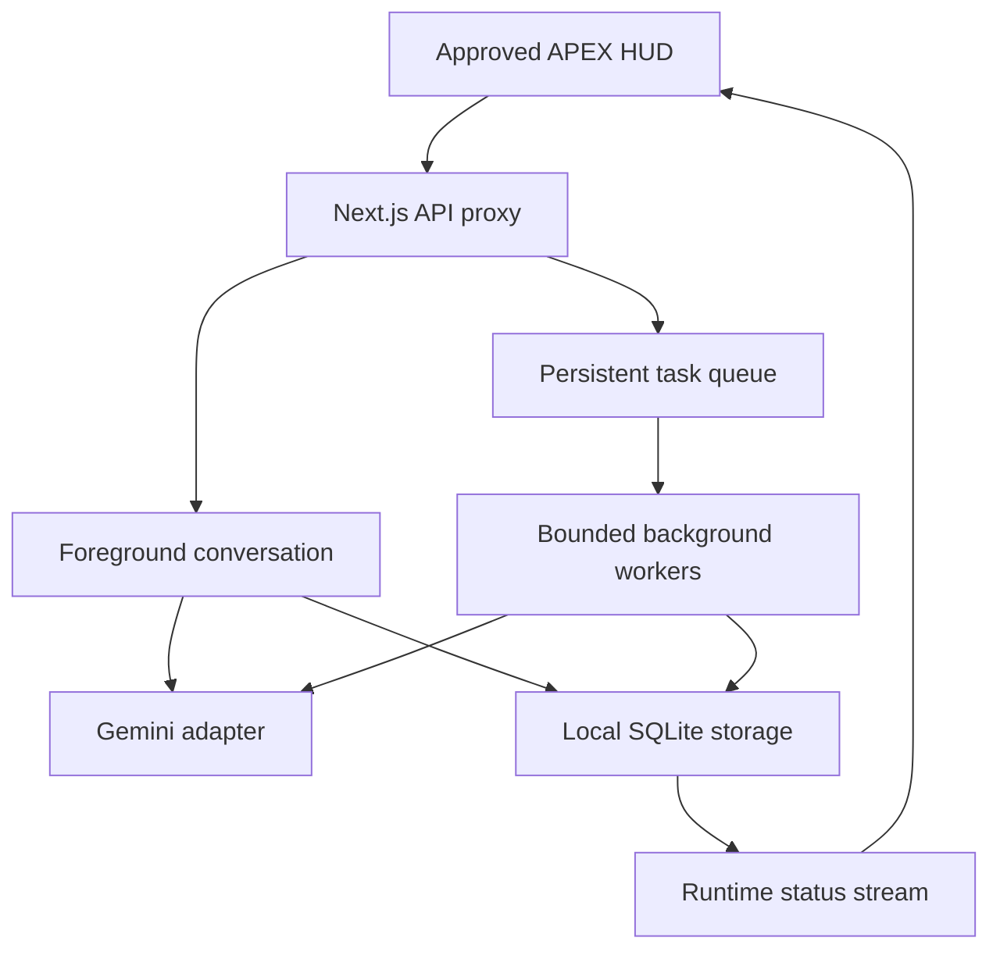

# APEX backend structure and development plan

Prepared for Idham Razali · Stage 4.6 · 5 October 2026

Historical Stage 4.6 description below. Current local Qwen, natural task routing, voice and inference priority are documented in [LOCAL-BRAIN-VOICE.md](LOCAL-BRAIN-VOICE.md); the active roadmap is [DEVELOPMENT-PLAN.md](../DEVELOPMENT-PLAN.md).

The approved galaxy HUD, cyan/gold waveform and four-state core are retained. This milestone
extends the local backend. It does not connect new external accounts or services.

## Current structure

The UI defaults to localhost:3000 and the authenticated Node runtime to 127.0.0.1:8081.
The browser uses the same-origin API proxy. The runtime token and Gemini key stay on the server.
The runtime status stream sends current snapshots every 1.5 seconds. It is not model token streaming.
Weather and On this day have separate Next.js routes; clock/date follow the selected location timezone.

| Module | Current responsibility |
|---|---|
| `runtime/server.mjs` | Local authenticated HTTP API, status event stream, worker scheduler, shutdown |
| `runtime/engine.mjs` | Conversation locks, task commands, worker slots, ordered workflow execution, cancellation and recovery |
| `runtime/provider.mjs` | Gemini request, timeout, configured model and personality instructions |
| `runtime/store.mjs` | SQLite persistence for conversations, tasks, steps, workflows, memories and diagnostics |
| `runtime/diagnostics.mjs` | Twelve checks; reports missing configuration honestly |
| `lib/runtime-proxy.ts` | Same-origin checks, route allowlist, server-held runtime token |
| `lib/voice-controller.mjs` | Existing browser microphone/playback lifecycle and echo prevention |

## Implemented in Stage 4.6

- Two independent background jobs may run together; foreground chat does not wait for those jobs.
- Set `APEX_BACKGROUND_CONCURRENCY=1`, `2` or `3`; restart APEX after changing it. Invalid values fail startup.
- Each workflow keeps its own supplied source and runs dependent steps sequentially.
- Repeated scheduler ticks cannot start the same queued job twice.
- Cancelling one task does not cancel another. A freed slot can start the oldest queued job.
- Graceful shutdown retains partial results, marks interrupted work Needs review, and leaves queued work queued.
- Explicitly cancelled tasks stay cancelled. Interrupted tasks require an explicit retry after restart.
- The existing background status and agent indicators reflect multiple active jobs.
- Task control commands read real local records without an extra Gemini request.

| Chat command | Result |
|---|---|
| `/task Your instructions and supplied material` | Saves a background job and immediately returns a receipt |
| `/tasks` | Lists recent saved tasks and their states |
| `/status TASK_ID` | Reads current state, progress and any saved error |
| `/result TASK_ID` | Reads saved output, with its state so partial output is distinguishable |
| `/cancel TASK_ID` | Cancels queued work or asks the running worker to stop |
| `/retry TASK_ID` | Creates a new run from a failed/interrupted task's original snapshot |

Use the full ID or its first eight characters. Ambiguous IDs are rejected. Task initiation remains
explicit through `/task` or the existing Tasks/Loops workspaces. Automatic natural-language routing
is planned, not implemented. Cancellation is local: it cannot guarantee an upstream provider has not
already processed or billed a submitted request. Provider failures do not silently create paid retries.

## How conversation stays available

Example: you queue a supplied-notes summary and a draft weekly update. Each gets a worker slot and
separate task context. While both are pending, a normal chat message uses the foreground conversation
path. A third job waits until a slot opens. Provider quotas and response times still apply.

The core follows the conversation: idle, listening, processing or speaking. Background job activity
has its own status. APEX can therefore display Listening while background work continues. The current
voice mode pauses recognition during assistant playback; simultaneous speech interruption is a later milestone.

## Next milestones, in order

The first task execution loop is now implemented: bounded planning, registered text steps, model result reviews, one revision per step, and persisted progress/results. See [TASK-LOOP.md](TASK-LOOP.md). Natural-language routing and external action handlers remain future work; `/loop` and the Tasks panel explicitly start a loop.

| Stage | Planned work | Completion evidence |
|---|---|---|
| 4.7: Orchestration | Interpret explicit background-work requests in ordinary language; validate structured task plans; route only to configured handlers; ask when intent is ambiguous | Natural-language request creates a real job receipt; ordinary chat stays chat; unavailable actions are rejected |
| 4.8: Conversation and voice | Stream replies, measure first-response latency, improve playback recovery and completion announcements; retain microphone consent and self-echo guard | Recorded timing results; no self-triggered messages; completion announcement waits until the user finishes speaking |
| 4.9: Memory and skills | Search relevant memories instead of only recent records; add source/date/provenance; define discoverable skill schemas, input validation and permissions | Relevant recall, edit/delete reflected immediately, only registered tools executable |
| 5.0: Research | Add a chosen search/read connector and source-backed outputs; supply citation records to the UI | Results traceable to fetched sources; unavailable sources reported; no fabricated browsing |
| 5.1: External actions | Connect email/calendar and later social accounts; draft/preview, explicit approval, execution receipt, audit trail and duplicate prevention | No send/publish before approval; approved action matches preview; retries cannot duplicate the action |
| 5.2: Scheduled work | Persistent schedules, weekly research briefings, missed-run policy, completion notifications | One run per scheduled occurrence; restart/sleep behavior documented; failures remain visible |
| 5.3: Windows actions | Limited registered desktop actions, explicit confirmation for shutdown/restart/Wi-Fi changes, undo where technically possible | Tested action results and refusal of unregistered commands; no unsupported undo claims |

No new paid service is selected or enabled in this stage. Provider/integration choices requiring paid
services need your approval before connection. Gmail, Calendar, social publishing, Whisper, Fish Audio,
LiveKit and Windows control are not connected in this build. Existing browser voice remains available.

## Agent capability map

| Role | Current capability | Planned extension |
|---|---|---|
| APEX / Chief of Staff | Text synthesis, task queue and status | Validated delegation and prioritisation |
| Memory | Explicit local save, recall, edit and delete | Relevance-based retrieval with provenance |
| Researcher | Analyse user-supplied material | Connected web research with sources |
| Strategist | Recommendations from supplied goals/evidence | Scheduled reviews and feedback history |
| Editor | Revise supplied text | Document workflows through registered tools |
| Social Media | Draft captions only | Approval-gated scheduling and publishing |
| Sales & CRM | Not connected | Lead intake and approved CRM updates |
| Operations & Logistics | Not connected | Inventory data and supply alerts |
| Analytics & Strategy | Not connected as an external-data agent | Reports from connected business datasets |

The existing text roles share the Gemini adapter with different instructions. They are not independent
external-service integrations. The visible agent map must always follow registered capabilities.

## Local data and validation

Data stays in `.apex-data/apex.sqlite` unless `APEX_DATA_DIR` points elsewhere. When moving to this
build, stop the old APEX process and copy its `.apex-data` directory into the new project folder (or
use the same absolute APEX_DATA_DIR). Copy your private `.env.local` separately. The package contains
neither your keys nor your personal database. Do not run two APEX runtimes against the same database.

Stage 4.6 validation uses controlled provider fixtures, not the user's Gemini account. The production
build and automated tests validate local behavior. Live Gemini, actual microphone playback and Windows
launcher behavior still need validation on the user's machine with their configured services.
